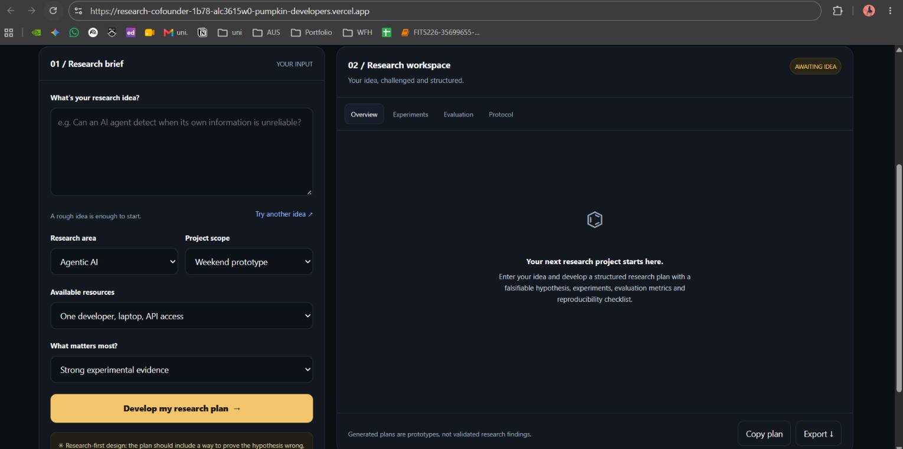

# 🔬 Research Buddy

### Your AI partner for turning ideas into experiments.

Research Buddy is an AI-powered research planning assistant that helps students, independent researchers, and AI practitioners transform early-stage ideas into structured, testable research plans.

Built to make research more approachable and systematic, Research Buddy helps users formulate research questions, develop falsifiable hypotheses, design experiments, identify evaluation metrics, assess risks, and organise actionable next steps.

The goal is simple: **make it easier to move from curiosity to rigorous experimentation.**

## 🌐 Live Demo

**Try Research Buddy:** [Open the web application](https://research-cofounder-1b78-qfp2c3kw6-pumpkin-developers.vercel.app/)


## 📸 Website Preview




## ✨ Key Features

- **Research Question Formulation:** Turn broad ideas into focused, researchable questions.
- **Hypothesis Development:** Create hypotheses that can be tested and potentially falsified.
- **Research Gap Exploration:** Identify potential gaps and questions to investigate before claiming novelty.
- **Experimental Design:** Structure controlled experiments, baselines, and ablation studies.
- **Evaluation Metrics:** Define measurable criteria for evaluating experimental outcomes.
- **Risk Assessment:** Identify methodological limitations, feasibility challenges, and potential failure conditions.
- **Reproducibility Planning:** Organise procedures and steps for more transparent, repeatable research.
- **Actionable Next Steps:** Break research goals into practical tasks.
- **Customisable Research Plans:** Tailor outputs to the research area, project scope, available resources, and primary objective.

## 🧠 How It Works

Research Buddy combines a browser-based interface, a Python API, and the OpenAI API.

1. **Share an idea:** Describe the problem or research concept you want to explore.
2. **Configure your project:** Select the research area, project scope, resources, and priority.
3. **Generate a research plan:** The frontend sends your inputs to the backend.
4. **Structure the output:** The backend requests a structured response from the AI model using a JSON Schema.
5. **Review your plan:** Explore the generated research question, hypothesis, experiments, metrics, risks, protocol, and next steps.

The generated plan is a starting point for investigation, not a substitute for literature verification or empirical evidence.

## 🏗️ Architecture

```text
User
  |
  v
Frontend
HTML, CSS, JavaScript
  |
  | POST /api/research
  v
Python API on Vercel
  |
  | Validate inputs
  v
OpenAI API
  |
  | Structured JSON response
  v
Research plan rendered in the UI
```

## 🛠️ Technology Stack

| Component | Technology |
|---|---|
| Frontend | HTML, CSS, JavaScript |
| Backend | Python |
| AI integration | OpenAI API |
| Structured output | JSON Schema |
| Hosting | Vercel |
| Version control | Git and GitHub |

## 📁 Project Structure

```text
research-buddy/
├── api/
│   └── research.py
├── index.html
├── requirements.txt
├── pyproject.toml
├── vercel.json
└── README.md
```

### Core Files

- `index.html`: User interface, configuration controls, API requests, and research-plan display.
- `api/research.py`: Request validation, OpenAI API integration, and structured JSON responses.
- `requirements.txt`: Python package dependencies.
- `pyproject.toml`: Python project metadata and dependency configuration.
- `vercel.json`: Deployment build and routing configuration.
- `README.md`: Project documentation.

## 🚀 Getting Started

### Prerequisites

- Git and a GitHub account.
- A Vercel account for deployment.
- An OpenAI API key with API access and available quota.
- Python and pip for local dependency installation.

### 1. Clone the Repository

```bash
git clone https://github.com/YOUR_USERNAME/research-cofounder.git
cd research-cofounder
```

Replace `YOUR_USERNAME` with your GitHub username.

> The repository may continue to use its existing `research-cofounder` name even though the product is now called Research Buddy.

### 2. Install Dependencies

```bash
pip install -r requirements.txt
```

### 3. Configure Your API Key

Add the following environment variable in your deployment settings:

```text
OPENAI_API_KEY=your_openai_api_key
```

In Vercel, open your project settings, find **Environment Variables**, and add `OPENAI_API_KEY`.

Never expose the API key in frontend JavaScript, commit it to GitHub, or include it in screenshots.

### 4. Deploy with Vercel

1. Import the repository into Vercel.
2. Configure the required environment variable.
3. Deploy the project.
4. Open the deployed website and submit a research idea to test the application.

## 🔐 Security and Input Validation

The backend validates request size, checks that the research idea is provided, and restricts configuration values to supported options.

The OpenAI API key is accessed server-side through an environment variable. Structured model output helps maintain a predictable response format for the frontend.

For broader production use, consider additional request throttling, abuse prevention, usage monitoring, and operational logging.

## 🔬 Research Philosophy

Research Buddy is designed around four principles:

- **Falsifiability:** Hypotheses should be testable and capable of being disproved.
- **Experimental rigour:** Use meaningful baselines and controlled comparisons where appropriate.
- **Measurable evaluation:** Define how success and failure will be assessed.
- **Reproducibility:** Document procedures, configurations, and limitations.

AI-generated plans can contain errors or overlook existing work. Verify claims against reliable sources and independently assess the proposed experiments before relying on them.

## 🛣️ Future Roadmap

Potential improvements include:

- Academic paper search and literature review integration.
- Citation-grounded research gap analysis.
- Saved research projects and version history.
- Experiment tracking and result comparison.
- Automated evaluation of research plans.
- Exportable research protocols and reports.
- Optional multi-agent workflows for literature discovery, experimental design, and critical review.

These are possible future extensions, not features currently claimed as implemented.

## 🤝 Contributing

Ideas, feedback, and contributions are welcome.

1. Fork the repository.
2. Create a feature branch.
3. Implement and test your changes.
4. Submit a pull request describing your contribution.

## ⚠️ Disclaimer

Research Buddy provides AI-assisted research suggestions. Its outputs may be inaccurate, incomplete, or infeasible. Researchers remain responsible for verifying claims, reviewing the literature, and evaluating the validity of proposed methods.

## 📄 License

Add a `LICENSE` file if you intend to distribute the project under an open-source license.

---

**Research Buddy: Better questions. Stronger experiments. One idea at a time.**
